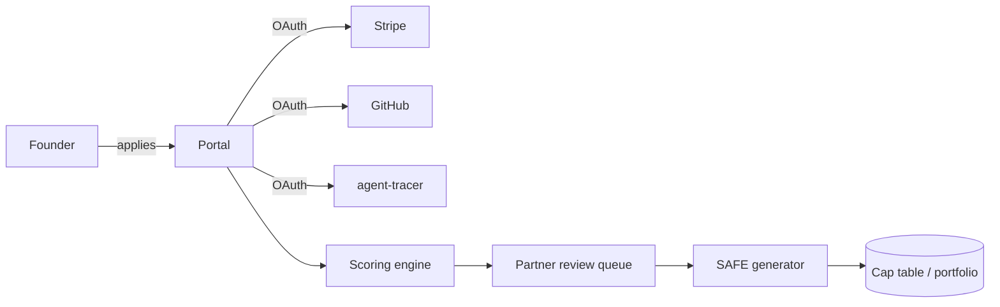

# Architecture — solo-combinator

## 1. Scope
Operating system for an accelerator that backs one-person companies run with agents.
**MVP:** application scoring (5 weighted dimensions + red flags), batch ranking, post-money SAFE math.
**Product:** application portal with verified metrics, partner review workflow, portfolio tracking.

## 2. System context

## 3. Components
| Module | Responsibility | Status |
|---|---|---|
| `Application` | Normalised applicant metrics, tolerant `from_dict` | MVP |
| `score_application` | Per-dimension 0–100 scores, weighted total, flags, decision | MVP |
| `rank` | Batch ordering for a cohort | MVP |
| `post_money_safe` | Ownership at conversion and after a priced round | MVP |
| Metric verifier | Pull MRR from Stripe, ship cadence from git, agent counts from tracer | Roadmap |
| Review workflow | Partner notes, overrides with reasons, calibration across partners | Roadmap |

## 4. Scoring model
`total = Σ w_d · score_d` with traction (log-scaled MRR), growth (MoM vs 20% target), leverage
(agents, automation share, revenue/human), efficiency (burn multiple, runway), velocity (ships/week).
Decisions: `accept ≥ 65 with no flags`, `interview ≥ 45`, else `pass`. Flags (runway < 3 mo,
no revenue + no users, > 1 human) block auto-accept but never auto-reject: a human always decides.
Custom weights (`rank --weights`, and the same field over the API) merge over the defaults and
are normalized to sum to 1; unknown dimensions, negative, non-finite, or all-zero weights are
rejected, so a custom rubric cannot silently drop a dimension.

## 5. Design decisions
- **Transparent weighted rubric, not a black-box model.** Founders get the breakdown, and partners
  can argue weights. *Trade-off:* it's gameable if metrics are self-reported, so metric
  verification is the top roadmap item.
- **Log-scaled traction.** The step from $0 to $5k MRR is as meaningful as $5k to $50k.
- **Post-money SAFE only.** It's the current market standard; pre-money and caps with discounts are deferred.

## 6. Production architecture
- Portal (Next.js) + API (FastAPI) + Postgres (applications, scores with `model_version`, decisions, deals).
- Verifier workers with OAuth tokens stored in a KMS-encrypted secrets table; nightly re-pulls.
- Every score is persisted with its inputs and weights version → reproducible decisions.

## 7. Security & fairness
- Founder financial data is encrypted at rest, and partners see only aggregates unless the founder
  grants detail access.
- Bias audit: score distributions by geography and background are reviewed each cohort, and the
  weights are published.

## 8. Risks
- Over-indexing on early revenue misses research-heavy ideas. A partner override path with a
  required rationale handles that.

## 9. Limitations (sell-ready audit, 2026-10-27)
- Metrics are self-reported: there is no live verification from Stripe, GitHub, or agent-tracer
  yet (roadmap item in §3). Scores are only as honest as the input.
- No enforced monthly application cap: Angel's former "100 a month" claim was removed from
  sales copy because it was not enforced in code. Fund is unlimited in the same sense.
- Program ($1,500/cohort) is a done-with-you service, not self-serve software, and is not
  sold through Stripe checkout, which is subscription-only in this codebase. Self-serve
  checkout covers Angel and Fund.
- Docker build and a live Render/Fly deployment were not verified in the audit environment
  (no Docker binary there); Dockerfile, render.yaml, and fly.toml are the same template
  shape as vibe-lube, but a deployment claim remains "not verified" until one is actually made.
- Stripe prices themselves were not verified against a live Stripe account in this run;
  the code handles checkout and revocation in tests with mocked Stripe calls, and the
  README example now uses `angel`/`fund` plan keys to match the plan names.
